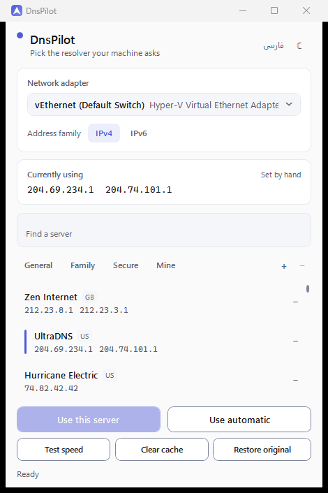
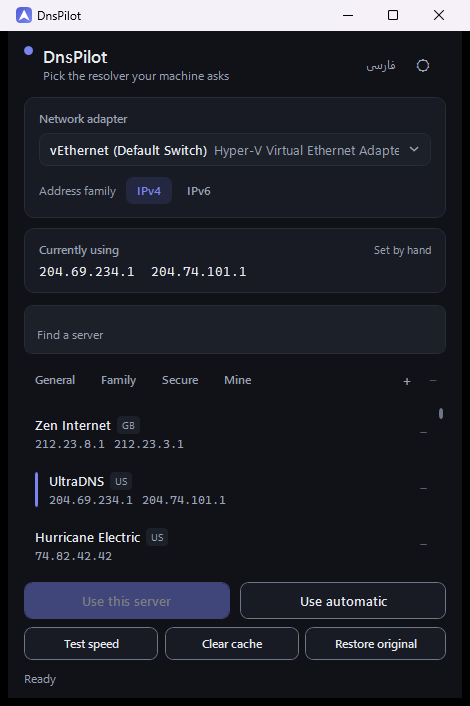
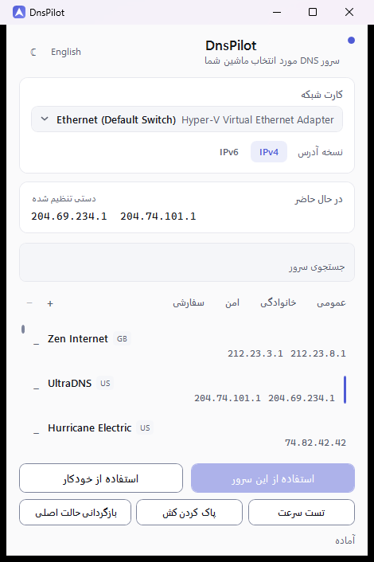
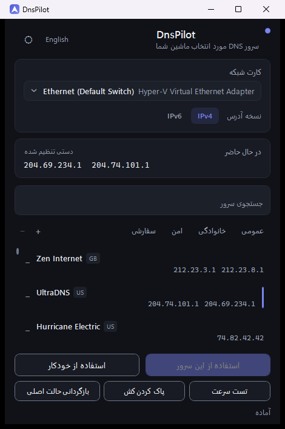

<p align="right"><a href="README.fa.md">فارسی</a></p>

<p align="center">
  
</p>

# DnsPilot

[](https://github.com/Ekkh1300/DnsPilot/actions/workflows/ci.yml)

A small, fast DNS switcher for Windows. Pick a network adapter, pick a resolver, apply it.

470 px wide. Runs elevated. English by default, with full Persian support.

| Light | Dark |
| --- | --- |
|  |  |

| فارسی (Light) | فارسی (Dark) |
| --- | --- |
|  |  |

## Install

Download `DnsPilot-Setup.exe` from the latest release and run it.

The installer is a single self-contained executable — no Inno Setup, no WiX, no runtime
prerequisite. Uninstalling returns **every** adapter's DNS to automatic (DHCP) rather than
leaving the machine on a resolver chosen inside an app that has just been removed, and it
reports which of those two outcomes actually happened.

Switches it accepts: `/LANG=fa` or `/LANG=en` forces the setup UI's language (otherwise it
follows Windows), `/DIR=<path>` picks the destination, and `/SILENT` installs without showing
the window. `/UNINSTALL` is the entry registered in Programs and Features.

## What it does

- **Apply a resolver** to a chosen adapter, or return to automatic.
- **63 preset resolvers** in 6 groups, imported from DNS Jumper's list and then re-verified
  against the network — see *The preset list* below.
- **Custom servers**, added and removed by hand.
- **Latency testing**, over a hand-written DNS wire encoder.
- **Backup and restore** of the adapter's original settings.
- **Cache flush**, straight from the main window.
- **Tray icon** — closing the window hides it; exiting lives only in the tray menu.

## How the latency test works

Most tools resolve a name and time the round trip. DnsPilot writes the DNS query packet
itself, then accepts an answer only if it matches the transaction id it sent **and** has the
response bit set. That check is what separates "this server answered me" from "something on
the path answered instead" — the difference matters on networks where a captive portal or an
ISP interceptor answers on port 53 for every name it does not recognise.

The test suite checks the encoder against hand-built byte literals: it asserts the exact
header flags, the length-prefixed labels, and the A and AAAA type codes, byte by byte. That
matters more than it sounds — an encoder that emits something merely plausible would still pass
a looser check, and a query the far end ignores is indistinguishable, from here, from a server
that is down.

Worth saying plainly: this was cross-checked once against .NET's own resolver during
development, and both agreed, but that comparison is not a repeatable test. What runs on every
build is the byte-level check above.

Failures say *why*, rather than one flat "failed":

| Shown | Means |
| --- | --- |
| `no answer` | The server stayed silent through three attempts. |
| `no route` | Your machine has no route to that network. **The server is not at fault.** |
| `refused` | The server answered, and refused the query. |
| `unreachable` | The host was reachable but reported itself unreachable. |
| `bad address` | The name did not resolve to a usable address. |
| `error N` | The server returned a DNS error code. |

That second row is not decoration. This machine has no IPv6 connectivity, so *every* IPv6
resolver fails identically — reporting that as twenty-odd dead servers would be both wrong and
alarming. DnsPilot distinguishes "this server is down" from "you cannot reach that network",
because they call for different actions.

## The preset list

The 63 presets came from DNS Jumper's server list, and were then measured rather than trusted:

- **138 addresses** were swept.
- **15 had stopped answering** — zero replies across five attempts — and were retired, each
  with a documented reason in `tools/Import-DnsJumper.ps1`. Re-running the importer reproduces
  the list exactly.
- **Every IPv6 entry was kept**, including ones that failed from this machine. They failed
  because *this machine has no IPv6 route at all*, not because the servers are down. Google,
  Cloudflare and Quad9's IPv6 resolvers are certainly live; pruning them here would have been
  an error dressed up as tidiness.

## Building

Requires the .NET 8 SDK.

```powershell
dotnet build DnsPilot\DnsPilot.csproj -c Release
dotnet test  DnsPilot.Tests\DnsPilot.Tests.csproj
```

To produce the installer:

```powershell
powershell -NoProfile -ExecutionPolicy Bypass -File DnsPilot\installer\build.ps1
```

`DnsPilot\installer\build.ps1` takes every path from its own location (`$PSScriptRoot`), so it
runs from any working directory, and it does exactly three things:

1. **Publish.** `dotnet publish DnsPilot.csproj -c Release -r win-x64 --self-contained true` into
   `%TEMP%\dnspilot-payload`, which is cleared first and resolved to a long path — the FileSystem
   provider will not delete through a `C:\Users\NAME~1\` short name. *Self-contained* is what lets
   the installer promise no runtime prerequisite: 464 files, 160 MB.
2. **Compress.** `Compress-Archive` of that folder into `DnsPilot\dist\payload.zip` (67 MB).
3. **Compile.** `Setup.cs` through
   `C:\Windows\Microsoft.NET\Framework64\v4.0.30319\csc.exe` — the C# compiler that ships inside
   Windows — with `/resource:payload.zip,dnspilot.payload.zip` (the payload becomes a manifest
   resource of the installer itself — that single flag is why there is no Inno Setup or WiX
   step), `/codepage:65001` (the source is UTF-8 with no BOM; without the flag a C# 5 csc reads
   it as ANSI and every Persian string compiles into mojibake) and `/win32icon` (the generated
   app icon, so `DnsPilot-Setup.exe` shows the same face in Explorer and in its own title bar).

Step 1 needs the .NET 8 SDK and step 3 needs the .NET Framework 4 compiler; both are already on
Windows 10 or later, so nothing extra has to be installed to build the installer. The script
prints the MD5 of `DnsPilot\dist\DnsPilot-Setup.exe` as its last line — that is the hash quoted
in the release notes — and throws rather than carrying on at any of the three steps.

The icon is generated rather than drawn by hand: `tools\New-Icon.ps1` renders every frame from
geometry and writes `DnsPilot\Assets\dns-pilot.ico`. That script is the source of the icon —
the `.ico` is its output, so a change belongs in the script, not in the binary.

## Repository scripts

`tools\` holds everything that is not `dotnet build`, and each script says what it needs:

| Script | What it does | Runs in CI |
| --- | --- | --- |
| `tools\New-Icon.ps1` | Draws `DnsPilot\Assets\dns-pilot.ico` from geometry | no |
| `tools\Capture-Screenshots.ps1` | Recaptures the four screenshots above (self-elevates) | no |
| `tools\Import-DnsJumper.ps1` | Regenerates `DnsPilot\Data\presets.json` from DNS Jumper's INI | no |
| `tools\Sweep-Presets.ps1`, `tools\Measure-Dns.ps1`, `tools\Recheck.ps1` | Measure resolvers over a live network | no |
| `DnsPilot\installer\build.ps1` | Builds the installer | yes |

The four that stay out of CI do so for four different reasons, and the differences matter:

- **The icon would have to be compared byte for byte.** Its output is committed, so a CI check
  would mean regenerating it on the runner and asserting equality — but GDI+ rasterises with
  whatever version the runner ships, and an anti-aliasing difference would fail a build over
  nothing. What CI checks instead is the committed file's *shape*: a real `.ico` header and frame
  count, which catches the failure that actually matters — shipping the generic Windows icon
  again.
- **The screenshots need this machine's desktop.** The screenshot script drives the window
  through UI Automation and has to run at the same integrity level as the elevated app; a runner
  has no desktop to photograph.
- **The importer needs a file that is not in this repository.** DNS Jumper's `DnsJumper.ini` is not
  redistributed here, so nobody who has not downloaded it can repeat the conversion. CI checks the
  *result* instead: `PresetStoreTests` parses the committed `presets.json` and fails on a
  malformed one.
- **The sweep scripts describe one network on one day.** Their numbers are already recorded in
  `tools\sweep-results.json`; rerunning them on a shared runner would produce figures nobody can
  compare with those.

### The two machine-specific paths

`tools\Import-DnsJumper.ps1` is the only file in the repository that names a path on this
developer's disk:

```powershell
-Source      default 'C:\dns\DNS.Jumper.2.3\DnsJumper.ini'
-Destination default 'E:\dnspilot\DnsPilot\Data\presets.json'
```

Both are parameters rather than constants, so they are visible at the call site and can be
replaced without touching the script:

```powershell
powershell -NoProfile -ExecutionPolicy Bypass -File tools\Import-DnsJumper.ps1 `
    -Source D:\DnsJumper.ini -Destination DnsPilot\Data\presets.json
```

A missing source fails immediately with that message instead of a `ReadAllBytes` error, and
running it on this machine reproduces the committed `presets.json` byte for byte.

Nothing else in the repository depends on `C:\` or `E:\`: `build.ps1` derives every path from its
own location, and `presets.json` is compiled in as an `EmbeddedResource`, so the app reads it
from inside the assembly rather than through a file path.

## Tests

73 tests, covering the DNS wire format, the latency loop (measured against a resolver the test
itself runs on `127.0.0.1`), the preset store, and the view model — including the failure-reason
plumbing and the regression that stopped the **Use** button from enabling after a test completed.

```powershell
dotnet test DnsPilot.Tests\DnsPilot.Tests.csproj
```

### Continuous integration

Every push and pull request to `master` runs [the CI workflow](.github/workflows/ci.yml): build
both projects, run the suite, confirm the generated icon and the five images this README embeds
are present, then build the installer and keep it as a workflow artifact. The runner is Windows,
because `net8.0-windows` cannot load anywhere else.

What it never does is touch DNS. The suite contains no test that changes the machine's network
configuration and none that reaches the network at all — which is precisely what makes it safe
to run on a shared runner. See the comment at the top of `DnsPilot.Tests.csproj`.

## Notes

- **Administrator rights are required**, declared in `app.manifest`. Changing an adapter's DNS
  is a system-wide setting and Windows does not let a non-elevated process do it.
- **DNS is read from the registry and written through `netsh`.** Reading from
  `HKLM\SYSTEM\CurrentControlSet\Services\Tcpip\Parameters\Interfaces\{GUID}` is the only
  reliable way to see what an adapter is actually using; `netsh` is what Windows itself uses to
  set it. Its output is localized, which is why nothing is parsed out of it.
- **The UI is never a VPN.** It changes which DNS server your machine asks. It does not
  encrypt, tunnel, or hide your traffic, and it does not claim to.

## License

MIT
